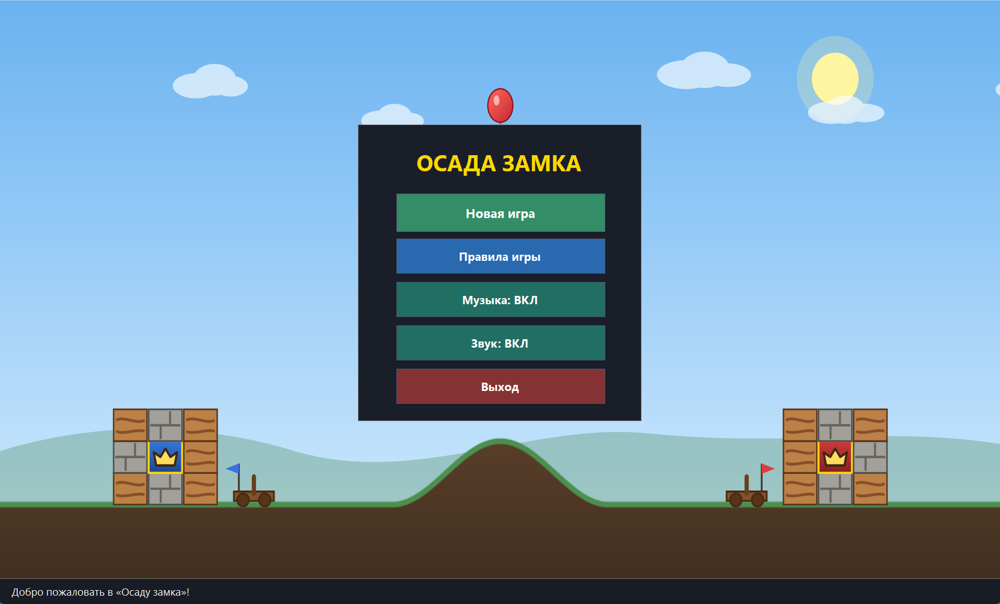
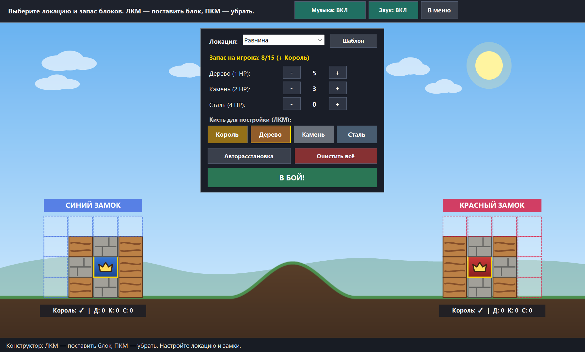
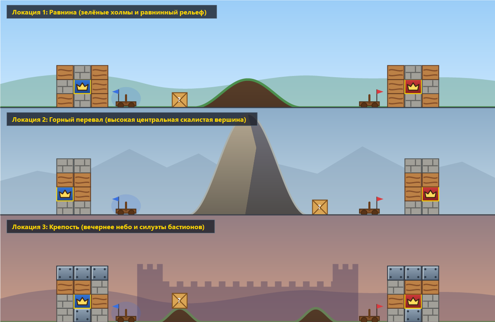
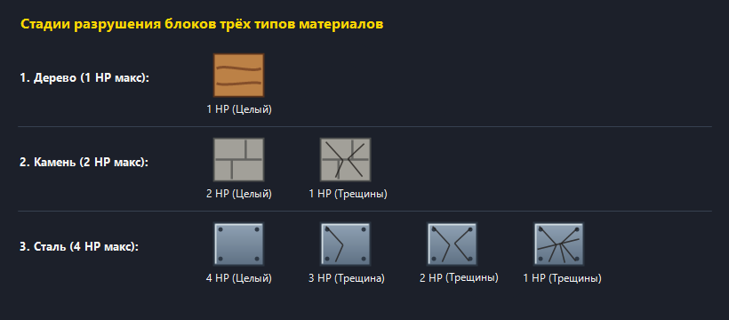

# Осада замка (CastleSiege)

Пошаговая тактическая 2D-артиллерийская дуэль для двух игроков за одним компьютером, написанная на **C# (.NET 9, Windows Forms)**.

> **Цель игры:** первым уничтожить Короля соперника прямым попаданием снаряда из катапульты. 

---

## Скриншоты игры

| Главное меню | Конструктор замка 4x4 |
| :---: | :---: |
|  |  |

| Боевой экран | Три локации (Равнина, Перевал, Крепость) |
| :---: | :---: |
|  |  |

---

## Материалы

В конструкторе игроки распределяют бюджет до **15 блоков** вокруг Короля. Более прочные материалы при получении урона покрываются трещинами и темнеют:

| Материал | Прочность | Стадии повреждений |
| :--- | :---: | :--- |
| **Дерево** | 1 HP | Разрушается с первого попадания |
| **Камень** | 2 HP | Целый (2/2) -> трещины (1/2) -> разрушен |
| **Сталь** | 4 HP | Целый (4/4) -> сколы (3/4) -> трещины (2/4) -> критический (1/4) -> разрушен |
| **Король** | 1 HP | Основная цель; с бонусом «Щит» выдерживает 1 прямое попадание |



---

## Боеприпасы и припасы

### Снаряды катапульты
- **Ядро (бесконечно)** - базовый снаряд.
- **Кассетный снаряд** - при клике ЛКМ или нажатии `Пробел` в полёте разделяется на 3 мини-ядра.
- **Рикошетная бомба** - отскакивает от земли и блоков 2 раза и взрывается на 3-е касание.

### Ящики с припасами
На карте одновременно может находиться до 2 ящиков (возрождаются через 3 полных раунда). При попадании снаряд исчезает и даёт случайный эффект:
- **Щит Короля** - поглощает 1 прямое попадание.
- **Ремонт замка** - восстанавливает `+1 HP` каждому повреждённому блоку.
- **Доп. боеприпас** - добавляет `+1` кассетный или рикошетный снаряд.
- **Туман прицела** - скрывает траекторию у соперника на 1 ход.
- **Диверсия** - наносит `-1 HP` до 3 случайным блокам вражеского замка.

---

## Управление

- **Конструктор:** `ЛКМ` - поставить блок, `ПКМ` - убрать блок, авторасстановка по текущему бюджету.
- **Стрельба:** зажмите `ЛКМ` у своей катапульты, оттяните тетиву назад и отпустите (попытка выстрела в обратную сторону блокируется).
- **Отмена прицела:** `ПКМ` или `Esc` во время натяжения тетивы.
- **Разделение кассеты:** `ЛКМ` или `Пробел` во время полёта.

---

## Запуск и проверка

Для разработки в VS Code настроены задачи (`.vscode/tasks.json`):
1. Линтер и строгая сборка: **Run Build Task** (`Ctrl+Shift+B`).
2. Запуск юнит-тестов: **Run Test Task**.

Либо напрямую из терминала (требуется **.NET 9 SDK**, Windows):

```bash
# Запуск игры
dotnet run --project CastleSiege

# Запуск юнит-тестов (12 тестов xUnit)
dotnet test CastleSiege.sln

# Проверка форматирования и строгая сборка
dotnet format whitespace CastleSiege.sln --verify-no-changes
dotnet build CastleSiege.sln -warnaserror
```

---

## Структура проекта

```text
CastleSiege.sln
├── CastleSiege/                # Основная игра (WinForms, GDI+, WinMM MIDI/WAV)
│   ├── Audio/SoundManager.cs   # Процедурный WAV-синтезатор и фоновая MIDI-музыка
│   ├── Engine/                 # GameEngine.cs, CastleBuilder.cs
│   ├── Models/                 # GameModels.cs, LevelData.cs, Projectile.cs
│   ├── Rendering/              # GameRenderer.cs (двойная буферизация, трещины, эффекты)
│   └── MainForm.cs             # Окно игры, меню, конструктор, правила
├── CastleSiege.Tests/          # Юнит-тесты (xUnit)
│   ├── CastleBuilderTests.cs   # Тесты конструктора, бюджета, щита и ремонта
│   └── CombatAndTerrainTests.cs# Тесты баллистики, снарядов и воронок
├── .vscode/tasks.json          # Задачи VS Code (линтер, сборка, тесты, запуск)
├── screenshots/                # Скриншоты для README
└── .github/workflows/ci.yaml   # GitHub Actions: джобы lint и test
```
